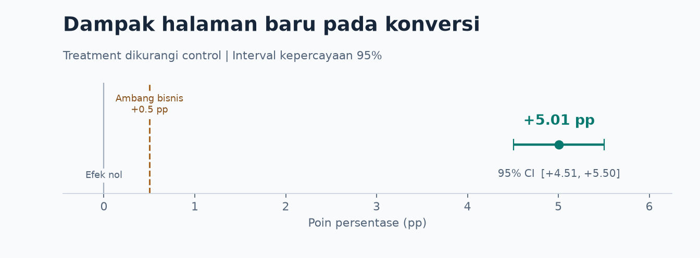

# A/B Test Halaman E-commerce

Studi kasus product analytics dengan Python. Apakah halaman baru meningkatkan tingkat konversi cukup besar untuk layak dirilis?

## Rekomendasi

**Tunda rilis penuh sampai pembagian trafik terverifikasi.** Halaman baru mencatat kenaikan **5,01 poin persentase** (IK 95% **+4,51 hingga +5,50**). Hasil tetap melampaui ambang bisnis yang diasumsikan, **+0,50 poin persentase**, setelah komposisi negara kedua grup disamakan.

**Langkah berikutnya.** Konfirmasi rasio alokasi yang direncanakan, lalu cocokkan log penugasan pengguna, paparan halaman, dan konversi. Jika targetnya 50/50, mulai pemeriksaan dari US, yang menyumbang selisih jumlah terbesar. Jika integritas data terkonfirmasi, pertimbangkan rilis bertahap.

## Hasil

| Grup | Observasi | Konversi | Tingkat konversi |
| --- | ---: | ---: | ---: |
| Control · halaman lama | 34.678 | 3.650 | 10,53% |
| Treatment · halaman baru | 35.211 | 5.469 | 15,53% |



## Audit pembagian trafik

| Negara | Control | Treatment | Proporsi treatment | Selisih treatment − control |
| --- | ---: | ---: | ---: | ---: |
| Kanada (CA) | 1.683 | 1.805 | 51,75% | +122 |
| Britania Raya (UK) | 8.795 | 8.756 | 49,89% | −39 |
| Amerika Serikat (US) | 24.200 | 24.650 | 50,46% | +450 |
| **Total** | **34.678** | **35.211** | **50,38%** | **+533** |

US menyumbang selisih terbesar berdasarkan jumlah. CA memiliki proporsi treatment tertinggi. Uji binomial dua sisi terhadap asumsi alokasi 50/50 dengan penugasan independen menghasilkan **p = 0,0442** secara keseluruhan. Interpretasinya bergantung pada rasio yang benar-benar direncanakan dan cara penugasan dijalankan.

## Uji sensitivitas

Bobot tiap negara dihitung dari proporsinya dalam sampel gabungan, lalu dipakai untuk kedua grup. Lift setelah standardisasi adalah **+5,01 poin persentase** (IK 95% **+4,51 hingga +5,50**), bergeser sekitar **0,0014 poin persentase** dari estimasi utama sebelum pembulatan. Komposisi negara yang teramati hanya sedikit memengaruhi estimasi. Validitas penugasan dan pencatatan tetap perlu diperiksa lewat log eksperimen.

## Metode dan cakupan

- Gunakan 69.889 baris dari dataset latihan Udacity. Notebook memvalidasi versi CSV, skema, nilai kosong, dan kategori yang diperbolehkan. [Sumber data dan deskripsi eksperimen](https://github.com/udacity/sdand-ab-testing-project/tree/e3aeae691f434eff812bd3c9c4a6f8c7cc2ec5df)
- Hitung tingkat konversi sebagai jumlah baris yang dikonversi dibagi jumlah baris dalam masing-masing grup. Estimasikan selisih treatment dikurangi control dengan interval Newcombe untuk dua proporsi independen.
- Untuk estimasi terstandardisasi, gunakan interval dengan pendekatan normal yang mengasumsikan bobot negara tetap dan observasi independen.
- CSV berisi negara, grup eksperimen, dan status konversi. Pemeriksaan pengguna duplikat, kecocokan paparan halaman, dan pola waktu membutuhkan data tambahan. Rasio alokasi aktual dan dampak pada pendapatan juga belum diketahui.

## Metrik pengaman untuk eksperimen berikutnya

Konversi tetap menjadi metrik utama. CSV Udacity hanya memuat hasil konversi biner, sehingga metrik pengaman di bawah adalah rancangan untuk tes berikutnya.

| Metrik | Cara hitung | Risiko yang dipantau |
| --- | --- | --- |
| Pendapatan bersih per pengguna | Total nilai produk setelah diskon dan refund, dibagi semua pengguna yang ditugaskan ke grup, termasuk pengguna yang tidak membeli. Gunakan satu mata uang pelaporan. | Konversi naik, tetapi pendapatan per pengguna turun. |
| Tingkat refund | Persentase pesanan berbayar yang menerima refund penuh atau sebagian. Hitung setiap pesanan maksimal satu kali. | Proporsi pesanan yang berakhir dengan refund naik. |

**Jendela usulan.** Masukkan pesanan berbayar dalam 7 hari sejak pengguna ditugaskan dan amati refund hingga 30 hari sejak pembayaran masing-masing pesanan. Catat ID pengguna, grup dan waktu penugasan, ID pesanan, waktu pembayaran, nilai produk setelah diskon, mata uang, serta waktu dan nilai refund.

**Aturan rilis.** Sebelum tes dimulai, sepakati penurunan pendapatan per pengguna dan kenaikan tingkat refund maksimum yang bisa diterima. Setelah jendela pengukuran lengkap, hitung interval kepercayaan 95% untuk selisih treatment dikurangi control dengan bootstrap pada tingkat pengguna di masing-masing grup. Bawa semua pesanan pengguna yang sama dalam setiap pengambilan sampel. Pertimbangkan rilis jika alokasi valid, konversi memenuhi kriteria utama, batas bawah interval selisih pendapatan berada di atas batas penurunan, dan batas atas interval selisih tingkat refund berada di bawah batas kenaikan. Jika hasil metrik pengaman belum meyakinkan, tunda rilis penuh.

## Rencana eksperimen ulang

1. **Penugasan.** Acak pengguna yang memenuhi syarat 50/50 saat pertama kali memenuhi kriteria tes, lalu pertahankan grupnya pada kunjungan berikutnya. Hitung konversi sebagai proporsi semua pengguna yang ditugaskan yang memiliki minimal satu pesanan berbayar dalam 7 hari. Catat versi halaman yang dilihat untuk mengaudit kecocokan paparan dengan penugasan.
2. **Ukuran sampel konversi.** Gunakan baseline historis **10,53%** sebagai asumsi awal. Jika efek sebenarnya **+1,00 poin persentase**, estimasi awalnya **61.582 pengguna per grup** atau **123.164 total**. Dengan pendekatan normal, jumlah ini memberi sekitar **80% peluang** agar batas bawah interval 95% melampaui ambang rilis **+0,50 poin persentase**. Notebook juga menghitung kebutuhan sampel untuk skenario efek lain.
3. **Ukuran sampel akhir.** Sepakati toleransi penurunan pendapatan dan kenaikan refund dengan tim produk dan keuangan. Gunakan riwayat pesanan dan refund pada tingkat pengguna untuk memperkirakan peluang ketiga syarat rilis terpenuhi bersamaan. Sesuaikan target sampel dan kunci aturan keputusan sebelum tes dimulai.
4. **Waktu keputusan.** Evaluasi setelah target sampel tercapai dan semua jendela pengukuran selesai. Pesanan pada akhir jendela konversi masih perlu dipantau selama 30 hari, sehingga pembacaan akhir dapat memerlukan hingga **37 hari setelah penugasan pengguna terakhir**.

## Simulasi keputusan rilis

Notebook memakai **data sintetis** untuk mendemonstrasikan keputusan setelah alokasi terverifikasi dan jendela pengukuran lengkap. Toleransi ilustratifnya adalah penurunan pendapatan sebesar **0,50 unit mata uang per pengguna** dan kenaikan refund sebesar **2,00 poin persentase**. Ketiga skenario melampaui ambang konversi **+0,50 poin persentase**.

| Skenario | Bukti dari interval 95% | Keputusan |
| --- | --- | --- |
| Semua syarat lolos | Pendapatan naik **1,50 hingga 3,02** per pengguna dan tingkat refund turun **0,64 hingga 2,72 poin**. | Pertimbangkan rilis bertahap |
| Pendapatan turun | Seluruh interval pendapatan berada di bawah batas penurunan **−0,50** per pengguna, dengan selisih **−2,70 hingga −1,36**. | Tahan rilis |
| Refund belum meyakinkan | Selisih refund **+0,63 hingga +3,04 poin** mencakup batas toleransi **+2,00 poin**. | Tunda keputusan sampai bukti cukup |

## Jalankan ulang

1. Unduh [CSV sumber](https://raw.githubusercontent.com/udacity/sdand-ab-testing-project/e3aeae691f434eff812bd3c9c4a6f8c7cc2ec5df/ab_data.csv) dan simpan sebagai `ab_data.csv` di folder proyek.
2. Dengan Python 3.12, instal dependensi di lingkungan Python yang akan dipakai notebook.

   ```sh
   python -m pip install -r requirements.txt
   ```

3. Buka [analysis.ipynb](analysis.ipynb) di VS Code dengan ekstensi Jupyter atau di JupyterLab. Pilih kernel dari lingkungan pada langkah 2, lalu jalankan semua sel. Notebook membuat ulang `conversion-lift.png`.

## Bullet CV

> Analyzed 69,889 observations from an e-commerce A/B test in Python, estimated a 5.01 percentage-point conversion lift that held after country standardization, and flagged a potential traffic allocation mismatch for investigation before rollout.
